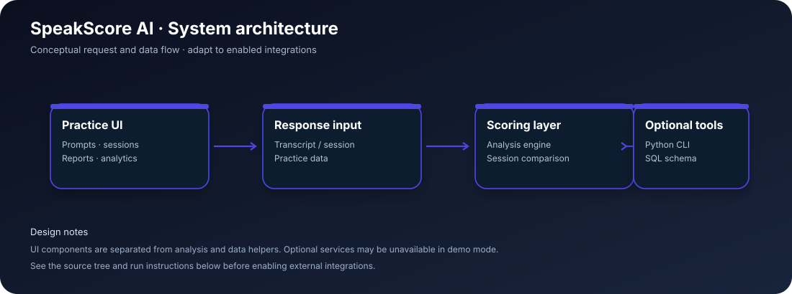

<div align="center">

# SpeakScore AI

### Interview rehearsal · Speaking analytics · Session reports

An interview-practice and speaking-analytics interface for rehearsing answers, reviewing transcript-based feedback, comparing sessions, and tracking progress through reports and analytics views.

</div>

<p align="center">
  
</p>

<p align="center">
  <strong>Product concept</strong> &nbsp;·&nbsp; <strong>Modular frontend</strong> &nbsp;·&nbsp; <strong>Developer-ready setup</strong>
</p>

---

## At a glance

| | Details |
|---|---|
| **Application** | SpeakScore AI |
| **Frontend** | React + TypeScript + Vite |
| **Styling / motion** | Tailwind CSS 4, custom CSS, Framer Motion where used |
| **Core experience** | Interview rehearsal · Speaking analytics · Session reports |
| **Run locally** | `npm install` → `npm run dev` |
| **Production build** | `npm run build` |

## Product visuals


> **Visual note:** the gallery below uses original artwork shipped with the app, not fabricated browser screenshots. Add fresh full-page screenshots here after launching the app locally if you want a true UI gallery for a portfolio or GitHub showcase.

## What it does

- Interview practice and prompt workflow
- Transcript-oriented speaking feedback
- Session report view
- Analytics and progress visualizations
- Compare sessions to inspect changes over time
- Optional Python analysis CLI for local experiments

## Technology stack

`React 19` · `TypeScript` · `Vite 7` · `Tailwind CSS 4` · `Framer Motion` · `Recharts` · `Lucide React` · `Python analysis CLI` · `SQLite schema`

The exact responsibilities of optional services and browser APIs are described below. This README documents the code included in this repository; it does not imply that third-party AI credentials, hosted model endpoints, or cloud services have been configured.

## Architecture



### Request and data flow

```text
Interview prompt → practice response / transcript → scoring engine
                                          ↓
                       report + analytics + session comparison
                                          ↓
                        optional Python CLI for analysis experiments
```

### Component / repository map

```text
src/
├── pages/          # Home, practice, report, analytics, compare
├── components/     # Visualizations, voice copilot, navigation/footer
├── lib/            # Engine, session and store helpers
├── App.tsx         # Application shell and routes
└── index.css       # Global styling
public/images/      # Hero, wave and AI coach artwork
server/             # Python analysis helper and SQL schema
vite.config.ts      # Vite configuration
```

## Getting started

### Prerequisites

- **Node.js:** use Node.js 22 LTS for the most consistent Vite/TypeScript toolchain. Check the `engines` field in `package.json` for the project-specific minimum.
- **npm:** included with Node.js.
- **Python:** required only for the optional Python helper/analysis path where noted below.
- A modern browser. Microphone-dependent features require permission and work best in a secure context (`localhost` is generally allowed).

### Install and launch

Run commands from the project root (folder containing `package.json`).

```bash
npm install
npm run dev
```

Open the local URL printed by Vite (usually `http://localhost:5173`). To inspect the optional Python analysis helper:

```bash
npm run analyze:help
```

### Build and quality checks

Run the checks supported by this project's `package.json`:

```bash
npm run lint
npm run build
```

A successful development-server start is not the same as a successful production build. Resolve any TypeScript, lint, or build output before deploying.

## Optional services and integrations

The website runs in the browser. `server/analyzer.py` is an optional command-line analysis helper; run `npm run analyze:help` to inspect its supported options. `server/schema.sql` documents the data schema.

## Configuration

- Review `package.json` for the scripts actually provided by this project.
- Review `vite.config.ts` for local development and proxy configuration.
- Do not commit API keys, private recordings, personal transcripts, or local database files.
- If you add external AI or speech providers, place credentials in environment variables and document required variable names in an `.env.example` file. Never publish real secrets in the README or source control.

## Deployment notes

1. Install dependencies using the supported Node.js version.
2. Run `npm run build` and make sure it finishes successfully.
3. Deploy the generated `dist/` directory to a static host that supports SPA fallback routing if client-side routes are used.
4. If you enable a separate API, deploy it independently and configure the frontend/API base URL and CORS policy for the production origin.
5. Keep optional backend services, database migrations, and model dependencies aligned with the deployment environment.

## Limitations and responsible use

Scores are coaching estimates and should not be interpreted as objective hiring decisions. Results depend on transcript quality and on which analysis capabilities are configured. The optional Python CLI is separate from the browser app.

## Troubleshooting

| Symptom | What to check |
|---|---|
| `npm` or `node` is not recognized | Install Node.js, restart the terminal, then run `node -v` and `npm -v`. |
| Dependency or TypeScript errors | Run `npm install` in the folder containing this README's `package.json`; then retry `npm run build`. |
| Port already in use | Stop the other process or use the port option supported by the relevant script. |
| Microphone permission denied | Allow microphone access in the browser and check the operating-system input device. |
| Optional API does not respond | Start its server in a second terminal and confirm its configured port and proxy. |
| Analysis results look like demo output | Check which local services/models are installed and enabled; the frontend alone does not guarantee hosted AI inference. |

## Project status

This repository is a development project. Verify the production build and the behavior of optional integrations in your own environment before presenting it as a production service. See the source files linked in the repository tree to trace each feature to its implementation.

---

<div align="center">

**SpeakScore AI** · Built with React, TypeScript, and a focus on clear product workflows.

</div>
